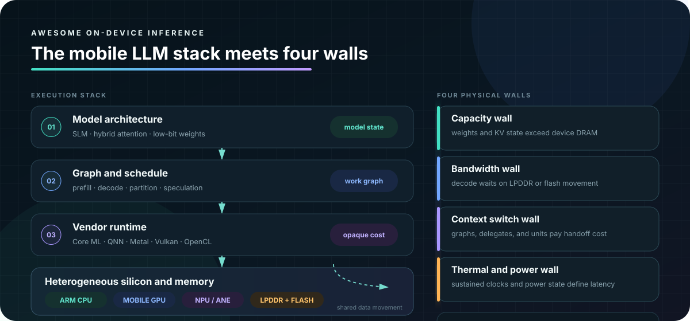

# Awesome On-Device Inference

> A curated list of papers, engines, and hardware characterization for **On-Device & Mobile LLM Inference Systems**, focusing on **GPU + NPU heterogeneous co-execution** (Apple Silicon ANE, Qualcomm Hexagon), the memory wall, and low-bit kernels.

  

This is a systems-first index. It asks where a technique sits in the execution stack, which hardware units it coordinates, and which physical constraint it relieves. It is not a leaderboard of small language models.

`Last verified: 2026-11-15`

## Contents

- [Start here](#start-here)
- [How to read the index](#how-to-read-the-index)
- [Heterogeneous NPU and GPU co-execution](#heterogeneous-npu-and-gpu-co-execution)
- [Memory wall, offloading, and KV state](#memory-wall-offloading-and-kv-state)
- [Speculative decoding and adaptive execution](#speculative-decoding-and-adaptive-execution)
- [Low-bit kernels and quantization](#low-bit-kernels-and-quantization)
- [Engines and runtimes](#engines-and-runtimes)
- [Mobile-native model architectures](#mobile-native-model-architectures)
- [Characterization, energy, and benchmarks](#characterization-energy-and-benchmarks)
- [Reading paths](#reading-paths)
- [Contributing](#contributing)
- [License](#license)

## Start here

For the core thesis of GPU + NPU co-execution, read these in order:

1. [Fast On-device LLM Inference with NPUs](https://doi.org/10.1145/3669940.3707239) shows how fixed-shape NPU graphs can be split into reusable prompt chunks while outliers and unsupported work move to other processors.
2. [Characterizing Mobile SoC for Accelerating Heterogeneous LLM Inference](https://doi.org/10.1145/3731569.3764808) studies when a mobile SoC can execute LLM work across GPU and NPU and when the transfer or synchronization cost defeats the split.
3. [Is Your NPU Ready for LLMs?](https://arxiv.org/abs/2607.05475) tracks the gap between peak NPU arithmetic and sustained LLM inference through cache capacity, memory bandwidth, dispatch, DVFS, and synchronization.

The common lesson is that heterogeneous execution is a scheduling and data-movement problem, not an arithmetic-only problem. A useful result must identify which unit owns each phase, what crosses the shared-memory boundary, and what happens when thermal or power state changes.

## How to read the index

Each entry records the highest available publication status. `arXiv` means the public record is a preprint. `ACM`, `IEEE`, and named venues refer to peer-reviewed records when a DOI is available.

Hardware tags describe the units exercised by the work:

| Tag | Meaning |
| --- | --- |
| `[ANE]` | Apple Neural Engine or a Core ML to ANE path |
| `[Hexagon]` | Qualcomm Hexagon NPU |
| `[Mobile-GPU]` | Adreno, Mali, Apple GPU, or another mobile GPU |
| `[ARM-CPU]` | ARM application processors |
| `[NPU]` | NPU when the public record does not name a specific vendor unit |
| `[PIM]` | Processing in or near memory |

Bottleneck tags describe the primary constraint:

| Tag | Meaning |
| --- | --- |
| `[Prefill]` | Prompt processing or the prefill phase |
| `[Decode]` | Token generation or the decode phase |
| `[KV]` | KV cache creation, transfer, reuse, or eviction |
| `[Offload]` | Weights or state move between DRAM, flash, and accelerators |
| `[Quant]` | Low-bit representation or activation range control |
| `[Schedule]` | Cross-unit partitioning, timing, or dispatch |
| `[Energy]` | Power or sustained-performance behavior |
| `[Char]` | Measurement, profiling, or benchmarking |

System tags describe the kind of contribution:

| Tag | Meaning |
| --- | --- |
| `[Architecture]` | Model structure changes persistent state or execution cost |
| `[Engine]` | End-to-end runtime or deployment system |
| `[Flash]` | Weight or state streams from external storage |
| `[Mobile]` | Mobile-class device when a more specific unit tag is unavailable |
| `[MoE]` | Expert routing or expert residency is central |
| `[OS]` | Operating-system memory or resource policy is central |

## Heterogeneous NPU and GPU co-execution

| Work | Venue | Why it matters | Tags |
| --- | --- | --- | --- |
| [Fast On-device LLM Inference with NPUs](https://doi.org/10.1145/3669940.3707239) | ASPLOS 2025 | Splits prompt work into reusable NPU graph chunks and offloads unsupported or outlier-sensitive work to CPU or GPU components. | `[Hexagon]` `[Mobile-GPU]` `[Prefill]` `[Schedule]` |
| [Characterizing Mobile SoC for Accelerating Heterogeneous LLM Inference](https://doi.org/10.1145/3731569.3764808) | SOSP 2025 | Connects mobile SoC measurements to GPU + NPU partitioning decisions and identifies the cost of moving intermediate tensors. | `[Mobile-GPU]` `[NPU]` `[Schedule]` `[Char]` |
| [PowerInfer-2](https://arxiv.org/abs/2406.06282) | MobiSys 2024 | Runs a large sparse LLM on a smartphone through neuron-cluster scheduling, external-storage prefetch, and accelerator-specific placement. | `[ARM-CPU]` `[NPU]` `[Decode]` `[Offload]` |
| [Scaling LLM Test-Time Compute with Mobile NPU on Smartphones](https://doi.org/10.1145/3767295.3769382) | EuroSys 2026 | Uses the mobile NPU for parallel test-time compute and studies the system support needed for multi-path sampling and verification. | `[NPU]` `[Decode]` `[Schedule]` `[Energy]` |
| [CoDL](https://doi.org/10.1145/3498361.3538932) | MobiSys 2022 | Provides an early mobile CPU + GPU co-execution design using hybrid partitioning and synchronization-aware cost modeling. | `[ARM-CPU]` `[Mobile-GPU]` `[Prefill]` `[Schedule]` |
| [Hybe: GPU-NPU Hybrid System for Efficient LLM Inference with Million-Token Context Window](https://doi.org/10.1145/3695053.3731051) | ISCA 2025 | Organizes long-context LLM work across GPU and NPU to keep attention useful at million-token scale. | `[Mobile-GPU]` `[NPU]` `[KV]` `[Schedule]` |
| [HAWK: Heterogeneity-Aware KV Cache Transfer for Efficient GPU-NPU Phase-Disaggregated LLM Inference](https://arxiv.org/abs/2610.29873) | arXiv 2026 | Treats KV transfer as a first-class cost in phase-disaggregated GPU + NPU inference. | `[Mobile-GPU]` `[NPU]` `[KV]` `[Schedule]` |
| [HeteroMosaic: Exposing and Exploiting Heterogeneous Execution Opportunities for Energy-Efficient Edge LLM Inference](https://arxiv.org/abs/2607.12839) | arXiv 2026 | Searches for concurrent work across heterogeneous edge processors instead of mapping each phase to one fixed unit. | `[ARM-CPU]` `[Mobile-GPU]` `[NPU]` `[Schedule]` `[Energy]` |
| [When NPUs Are Not Always Faster: A Stage-Level Analysis of Mobile LLM Inference](https://arxiv.org/abs/2605.27435) | arXiv 2026 | Separates prefill, decode, and transfer stages to explain why the nominally faster NPU can lose end to end. | `[NPU]` `[Prefill]` `[Decode]` `[Char]` |
| [YODA: Engine-Level Design for Energy-Efficient LLM Inference on Mobile Devices](https://doi.org/10.1109/tmc.2026.3751036) | IEEE TMC 2026 | Optimizes the engine and runtime path around mobile energy behavior rather than arithmetic throughput alone. | `[NPU]` `[Energy]` `[Schedule]` |
| [RS-Infer: A Fast and Secure LLM Inference System for Mobile Devices with Recallable Resource Isolation](https://doi.org/10.1145/3828523.3857080) | ATC 2026 | Adds recallable resource isolation so mobile LLM inference can retain performance while limiting interference and exposure. | `[Mobile-GPU]` `[NPU]` `[Schedule]` |

## Memory wall, offloading, and KV state

| Work | Venue | Why it matters | Tags |
| --- | --- | --- | --- |
| [LLM in a flash: Efficient Large Language Model Inference with Limited Memory](https://arxiv.org/abs/2312.11514) | ACL 2024 | Streams weights from flash and changes memory access shape to run models larger than available DRAM. | `[Flash]` `[Decode]` `[Offload]` |
| [EdgeMoE: Empowering Sparse Large Language Models on Mobile Devices](https://arxiv.org/abs/2308.14352) | arXiv 2024 | Keeps routing state resident while moving selected MoE experts between storage and compute. | `[ARM-CPU]` `[Offload]` `[MoE]` |
| [STI: Turbocharge NLP Inference at the Edge via Elastic Pipelining](https://doi.org/10.1145/3575693.3575698) | ASPLOS 2023 | Pipelines bit-layer weight loading with computation to hide flash latency during bandwidth-bound transformer inference. | `[ARM-CPU]` `[Offload]` `[Decode]` |
| [FlexInfer: Breaking Memory Constraint via Flexible and Efficient Offloading for On-Device LLM Inference](https://arxiv.org/abs/2503.03777) | arXiv 2025 | Schedules tensor offloading around on-device memory limits and reuse opportunities. | `[Offload]` `[Decode]` |
| [D²MoE: Dual Routing and Dynamic Scheduling for Efficient On-Device MoE-based LLM Serving](https://arxiv.org/abs/2504.15299) | arXiv 2025 | Couples expert routing with dynamic scheduling to control memory residency and compute placement for local MoE serving. | `[MoE]` `[Offload]` `[Schedule]` |
| [NPUGen: NPU as KV Generator for Stable Long-Context Mobile LLM Inference](https://doi.org/10.1145/3795866.3844480) | MobiCom 2026 | Uses the NPU specifically for KV generation and examines how that placement changes long-context stability and movement cost. | `[NPU]` `[KV]` `[Prefill]` `[Decode]` |
| [ExoMem: OS-Governed Memory for Local Large-LLM Inference on Mobile Edge Devices](https://doi.org/10.1145/3795866.3844471) | MobiCom 2026 | Makes the operating system an actor in deciding how local LLM weights, KV state, and page traffic occupy memory. | `[OS]` `[KV]` `[Offload]` |
| [Dynamic Flow, Static Graph: KV Cache Reuse for Efficient LLM Serving on Mobile NPUs](https://arxiv.org/abs/2609.34727) | arXiv 2026 | Reuses KV state around the static graph constraints imposed by mobile NPU runtimes. | `[NPU]` `[KV]` `[Decode]` |
| [Rethinking Unified Memory for NPU-PIM Systems: Dual-View Memory for Dynamic Inference of LLM](https://arxiv.org/abs/2608.06989) | arXiv 2026 | Revisits unified memory for systems that combine NPU compute with near-memory processing. | `[NPU]` `[PIM]` `[KV]` `[Offload]` |

## Speculative decoding and adaptive execution

| Work | Venue | Why it matters | Tags |
| --- | --- | --- | --- |
| [LLMCad: Fast and Scalable On-device Large Language Model Inference](https://arxiv.org/abs/2309.04255) | arXiv 2023 | Uses a small draft model and tree-shaped verification to trade extra on-device compute for fewer bandwidth-bound decode steps. | `[Mobile]` `[Decode]` `[Schedule]` |
| [AHASD: Asynchronous Heterogeneous Architecture for LLM Adaptive Drafting Speculative Decoding on Mobile Devices](https://arxiv.org/abs/2604.25326) | arXiv 2026 | Runs adaptive drafting and verifier work asynchronously across different mobile processors. | `[Mobile-GPU]` `[NPU]` `[Decode]` `[Schedule]` |

## Low-bit kernels and quantization

| Work | Venue | Why it matters | Tags |
| --- | --- | --- | --- |
| [T-MAC: CPU Renaissance via Table Lookup for Low-Bit LLM Deployment on Edge](https://doi.org/10.1145/3689031.3696099) | EuroSys 2025 | Replaces unpack-and-multiply low-bit GEMV with table lookups tuned for edge CPUs. | `[ARM-CPU]` `[Quant]` `[Decode]` |
| [AWQ: Activation-aware Weight Quantization for LLM Compression and Acceleration](https://arxiv.org/abs/2306.00978) | MLSys 2024 | Protects salient weight channels using activation statistics and targets efficient low-bit inference kernels. | `[Quant]` `[Decode]` |
| [SpinQuant: LLM quantization with learned rotations](https://arxiv.org/abs/2405.16406) | ICLR 2025 | Learns rotations that reduce activation outliers before low-bit execution. | `[Quant]` `[NPU]` |
| [QuaRot: Outlier-Free 4-Bit Inference in Rotated LLMs](https://arxiv.org/abs/2404.00456) | NeurIPS 2024 | Applies computational invariance and rotation to move difficult activation distributions toward fixed-point execution. | `[Quant]` `[NPU]` |
| [FlatQuant: Flatness Matters for LLM Quantization](https://arxiv.org/abs/2410.09426) | arXiv 2024 | Optimizes transforms for flatter weight and activation ranges while considering deployment overhead. | `[Quant]` `[NPU]` |
| [Quant.npu: Enabling Efficient Mobile NPU Inference for on-device LLMs via Fully Static Quantization](https://arxiv.org/abs/2605.20295) | arXiv 2026 | Converts dynamic LLM behavior into an NPU-executable static quantization contract and measures the resulting constraints. | `[NPU]` `[Quant]` `[Schedule]` |
| [High-Throughput Non-uniformly Quantized 3-bit LLM Inference](https://doi.org/10.1145/3774934.3786423) | PPoPP 2026 | Designs inference support for non-uniform 3-bit representations instead of assuming uniform integer formats. | `[Quant]` `[Decode]` |

## Engines and runtimes

The support matrix is a starting point, not a conformance claim. Check the linked engine documentation before selecting a backend. `Delegate` means the engine exposes an extension point whose usable hardware path depends on the vendor runtime and device.

| Engine | Owner | CPU | Mobile GPU | NPU | Notes |
| --- | --- | --- | --- | --- | --- |
| [llama.cpp](https://github.com/ggml-org/llama.cpp) | Community | Yes | Metal, Vulkan | No stable cross-vendor path | Portable C/C++ runtime and GGUF weight format |
| [MLX](https://github.com/ml-explore/mlx) | Apple | Yes | Metal | No direct ANE path | Apple unified-memory array framework |
| [MLX-LM](https://github.com/ml-explore/mlx-lm) | Apple | Yes | Metal | No direct ANE path | LLM tooling built on MLX |
| [ExecuTorch](https://github.com/pytorch/executorch) | PyTorch | Yes | Delegate | Delegate | PyTorch export and mobile runtime with vendor backends |
| [MLC-LLM](https://github.com/mlc-ai/mlc-llm) | Community | Yes | Metal, Vulkan, OpenCL | Runtime-dependent | TVM-based compilation and portable deployment |
| [MNN](https://github.com/alibaba/MNN) | Alibaba | Yes | OpenCL, Vulkan | Delegate | Mobile runtime with CPU and vendor-specific paths |
| [LiteRT](https://github.com/google-ai-edge/LiteRT) | Google | Yes | GPU delegate | NPU delegate | Successor to the TensorFlow Lite runtime path |
| [BitNet.cpp](https://github.com/microsoft/BitNet) | Microsoft | Yes | No primary claim | No primary claim | CPU-focused ternary and low-bit inference |
| [MNN-LLM paper](https://doi.org/10.1145/3700410.3702126) | Alibaba | Yes | Yes | Runtime-dependent | System design behind the MNN mobile LLM path |
| [anemll](https://github.com/Anemll/Anemll) | Community | Yes | Metal | ANE through Core ML | Community ANE project. It is not an Apple-supported API. |
| [ANEForge](https://github.com/sbryngelson/ANEForge) | Community | Yes | Metal | ANE through Core ML | Community experiments with Apple Neural Engine execution |

## Mobile-native model architectures

| Work | Venue | Why it matters | Tags |
| --- | --- | --- | --- |
| [MobileLLM: Optimizing Sub-billion Parameter Language Models for On-Device Use Cases](https://arxiv.org/abs/2402.14905) | ICML 2024 | Studies depth, width, embedding sharing, and grouped attention for sub-billion-parameter on-device models. | `[Architecture]` `[Decode]` |
| [Apple Intelligence Foundation Language Models](https://arxiv.org/abs/2407.21075) | arXiv 2024 | Describes a device-side foundation-model stack with task adapters and deployment constraints. | `[ANE]` `[Architecture]` `[Quant]` |
| [Apple Intelligence Foundation Language Models: Tech Report 2025](https://arxiv.org/abs/2507.13575) | arXiv 2025 | Updates the public account of Apple's device and server model architecture and adaptation path. | `[ANE]` `[Architecture]` |
| [Griffin: Mixing Gated Linear Recurrences with Local Attention for Efficient Language Models](https://arxiv.org/abs/2402.19427) | arXiv 2024 | Combines recurrent layers with local attention to reduce the persistent state needed by full attention. | `[Architecture]` `[KV]` |
| [Transformers are SSMs: Generalized Models and Efficient Algorithms Through Structured State Space Duality](https://arxiv.org/abs/2405.21060) | ICML 2024 | Connects attention and state-space models through structured matrices and efficient block algorithms. | `[Architecture]` `[Prefill]` `[Decode]` |
| [Gated Delta Networks: Improving Mamba2 with Delta Rule](https://arxiv.org/abs/2412.06464) | ICLR 2025 | Adds a gated delta update to linear recurrent state and targets efficient sequence modeling. | `[Architecture]` `[KV]` `[Decode]` |
| [Empowering Hybrid Attention Models on NPUs](https://arxiv.org/abs/2609.32114) | arXiv 2026 | Adapts hybrid attention execution to NPU graph and operator constraints. | `[NPU]` `[Architecture]` `[Prefill]` `[Decode]` |

Mamba-family and hybrid recurrent models reduce attention KV growth, but they still carry fixed recurrent state. Evaluate their memory benefit and numerical behavior on the target device path rather than assuming zero state cost.

## Characterization, energy, and benchmarks

| Work | Venue | Why it matters | Tags |
| --- | --- | --- | --- |
| [MELTing Point: Mobile Evaluation of Language Transformers](https://doi.org/10.1145/3636534.3690668) | MobiCom 2024 | Evaluates language transformers on mobile devices and records sustained runtime behavior rather than peak throughput. | `[Mobile]` `[Char]` `[Energy]` |
| [Is Your NPU Ready for LLMs? Dissecting the Hidden Efficiency Bottlenecks in Mobile LLM Inference](https://arxiv.org/abs/2607.05475) | arXiv 2026 | Breaks NPU efficiency into cache, bandwidth, dispatch, synchronization, DVFS, and framework costs. | `[NPU]` `[Char]` `[Energy]` |
| [LLM Inference at the Edge: Mobile, NPU, and GPU Performance Efficiency Trade-offs Under Sustained Load](https://arxiv.org/abs/2603.23640) | arXiv 2026 | Compares edge processors under sustained load and makes thermal and power drift part of the result. | `[NPU]` `[Mobile-GPU]` `[Char]` `[Energy]` |
| [EnerInfer: Energy-Aware On-Device LLM Inference](https://arxiv.org/abs/2606.23001) | arXiv 2026 | Places energy behavior in the inference scheduling loop instead of reporting it after the fact. | `[Mobile]` `[Energy]` `[Schedule]` |
| [Efficient On-Device Diffusion LLM Inference with Mobile NPU](https://arxiv.org/abs/2606.13740) | arXiv 2026 | Studies diffusion-style LLM execution through a mobile NPU path. | `[NPU]` `[Decode]` `[Char]` |
| [When NPUs Are Not Always Faster: A Stage-Level Analysis of Mobile LLM Inference](https://arxiv.org/abs/2605.27435) | arXiv 2026 | Attributes end-to-end outcomes to stage-specific compute, transfer, and scheduling behavior. | `[NPU]` `[Char]` |
| [MNN-LLM: A Generic Inference Engine for Fast Large Language Model Deployment on Mobile Devices](https://doi.org/10.1145/3700410.3702126) | ACM Multimedia Asia Workshops 2024 | Documents the MNN mobile LLM engine, including device deployment and runtime optimizations. | `[ARM-CPU]` `[Mobile-GPU]` `[Engine]` |

## Reading paths

### Apple Silicon and ANE systems

Read [Apple Intelligence Foundation Language Models](https://arxiv.org/abs/2407.21075), [Is Your NPU Ready for LLMs?](https://arxiv.org/abs/2607.05475), and [Dynamic Flow, Static Graph](https://arxiv.org/abs/2609.34727). Then inspect the community [anemll](https://github.com/Anemll/Anemll) and [ANEForge](https://github.com/sbryngelson/ANEForge) projects for execution constraints exposed by Core ML.

### Heterogeneous co-execution

Read [Fast On-device LLM Inference with NPUs](https://doi.org/10.1145/3669940.3707239), [Characterizing Mobile SoC for Accelerating Heterogeneous LLM Inference](https://doi.org/10.1145/3731569.3764808), and [HeteroMosaic](https://arxiv.org/abs/2607.12839). Pay attention to transfer volume, synchronization frequency, graph switching, and ownership of KV state.

### Memory wall and long context

Read [LLM in a Flash](https://arxiv.org/abs/2312.11514), [STI](https://doi.org/10.1145/3575693.3575698), [NPUGen](https://doi.org/10.1145/3795866.3844480), and [ExoMem](https://doi.org/10.1145/3795866.3844471). Separate weight residency, KV residency, page traffic, and operating-system policy in the comparison.

### NPU-friendly low-bit inference

Read [T-MAC](https://doi.org/10.1145/3689031.3696099), [AWQ](https://arxiv.org/abs/2306.00978), [SpinQuant](https://arxiv.org/abs/2405.16406), and [Quant.npu](https://arxiv.org/abs/2605.20295). Record the weight and activation formats separately. A `W4A16` kernel does not demonstrate `W4A4` NPU execution.

## Contributing

Send a pull request when a paper, engine, or measurement changes how an on-device inference system handles compute placement, memory movement, synchronization, or sustained energy. Read [CONTRIBUTING.md](CONTRIBUTING.md) for the evidence requirements and entry format.

Corrections are welcome. Open an issue when a venue, link, backend claim, or entry description is wrong.

## License

[MIT](LICENSE)
